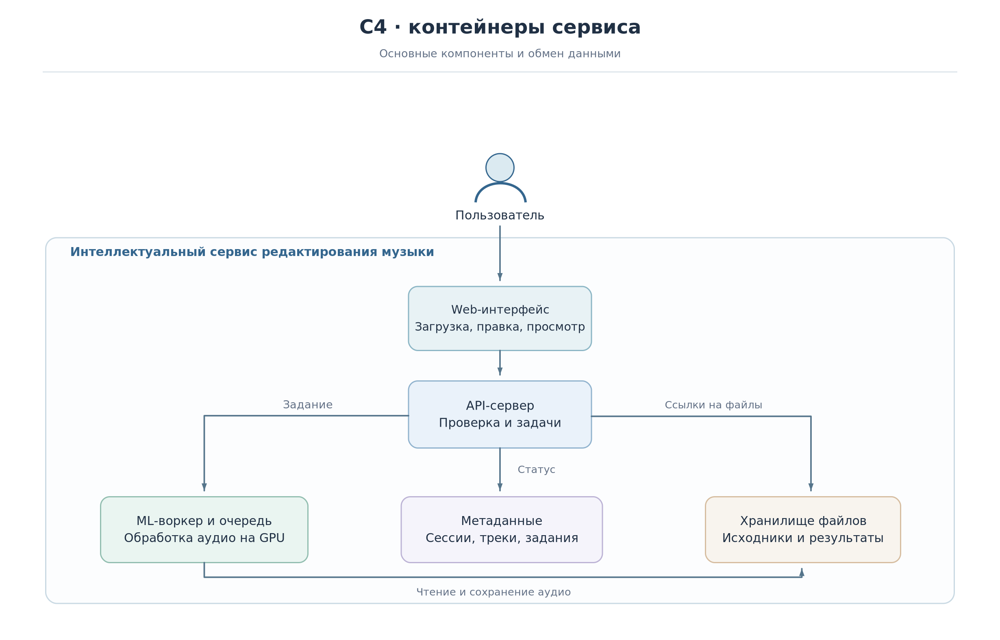
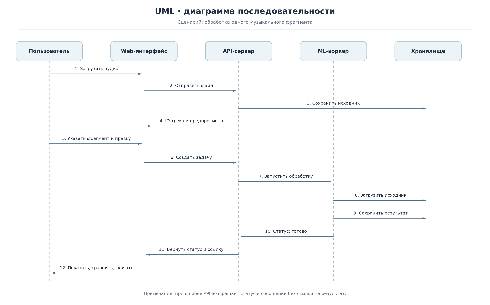
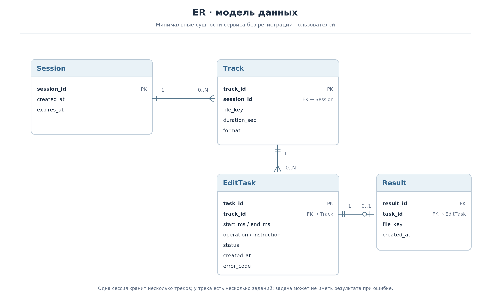
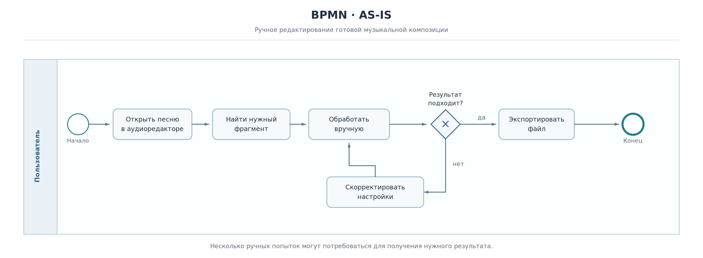
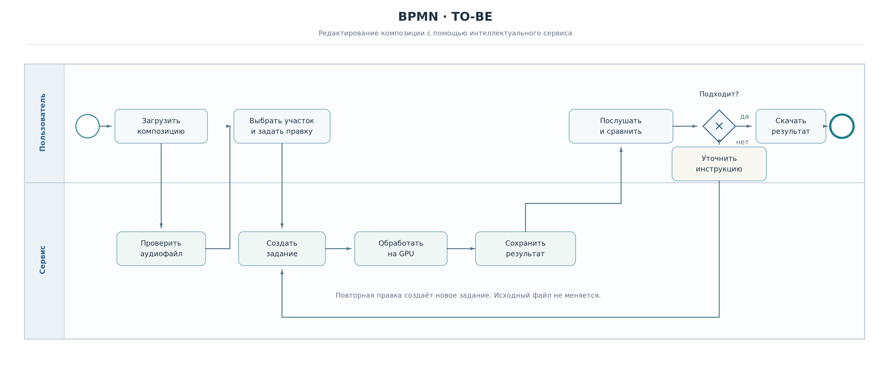

# ЛР 3 — проектирование

**Тема ВКР:** Разработка интеллектуального сервиса редактирования музыкальных композиций.

**Автор:** Селезнев И. А.

## 1. Предметная область и требования

### Описание предметной области

В рамках ВКР планируется сервис для редактирования готовых музыкальных композиций с помощью нейросети. Пользователь загружает аудиофайл, выделяет участок и задаёт нужное изменение. Сервис обрабатывает запись, показывает результат и позволяет скачать его.

Основной пользователь — человек, которому нужно изменить готовую музыкальную запись. Это может быть музыкант или обычный слушатель. Для работы не предполагается обязательная регистрация: файлы и задания связываются с рабочей сессией.

Возможные операции: удаление отдельного источника, изменение его звучания, замена или перегенерация фрагмента. В этой лабораторной проектируется общий процесс работы с сервисом. 

### Функциональные требования

| ID | Требование | Как проверить выполнение |
|---|---|---|
| FR-01 | Пользователь может загрузить музыкальный файл. | После загрузки появляется запись в текущей сессии. |
| FR-02 | Пользователь может прослушать исходную композицию. | Аудио воспроизводится в интерфейсе. |
| FR-03 | Пользователь может выбрать участок записи для редактирования. | Начало и конец участка сохраняются в параметрах задания. |
| FR-04 | Пользователь может выбрать доступную операцию и описать требуемое изменение. | Выбранный режим и текст инструкции передаются серверу. |
| FR-05 | Сервис может создать задание и передать его модулю обработки аудио. | Создаётся задание с уникальным идентификатором и статусом `queued`. |
| FR-06 | Пользователь видит состояние обработки и сообщение об ошибке при неудаче. | Интерфейс показывает статусы `queued`, `running`, `done` или `failed`. |
| FR-07 | Пользователь может прослушать результат и сравнить его с исходной записью. | В интерфейсе доступны оба варианта аудио. |
| FR-08 | Пользователь может изменить инструкцию и выполнить обработку повторно. | Создаётся новое задание, а исходный файл остаётся прежним. |
| FR-09 | Пользователь может скачать обработанный файл. | После успешного задания скачивается аудиофайл результата. |

### Нефункциональные требования

Численные ограничения ниже — **проектные значения**, а не результаты испытаний готовой программы. При реализации их можно уточнить.

| ID | Требование | Как проверить выполнение |
|---|---|---|
| NFR-01 | Сервис принимает WAV и MP3 размером до 100 МБ и длительностью до 5 минут. | Допустимые файлы принимаются. Файлы другого формата или превышающие лимит отклоняются с объяснением. |
| NFR-02 | Исходный файл не перезаписывается при редактировании. | Контрольная сумма исходника до и после обработки совпадает. |
| NFR-03 | Пользователь получает доступ только к файлам и заданиям своей сессии. | Запрос к файлу из другой сессии не выдаёт содержимое. |
| NFR-04 | На одном GPU одновременно выполняется не больше одного задания. Остальные находятся в очереди. | При одновременной отправке двух заданий второе ожидает завершения первого. |
| NFR-05 | Для каждого задания сохраняются статус, время создания и код ошибки при сбое. Содержимое аудио не записывается в журнал ошибок. | По идентификатору задания можно посмотреть эти поля. В журнале нет самого звукового сигнала. |
| NFR-06 | Редактирование не меняет длительность всей композиции. Допустимое расхождение — не более 0,1 секунды. | Длительности исходного и итогового файлов сравниваются автоматически. |

## 2. Обзор нотаций и видов диаграмм

| Нотация или вид диаграммы | Что описывает | Чем полезна |
|---|---|---|
| BPMN | Последовательность действий, участников и решений в процессе. | Показывает работу пользователя до и после внедрения сервиса. |
| IDEF0 | Функции системы, входы, выходы и механизмы выполнения. | Помогает разделить задачу на основные функции. |
| DFD | Потоки данных между процессами и хранилищами. | Удобна для описания передачи аудиофайлов и результатов. |
| UML Use Case | Возможности системы с точки зрения пользователя. | Показывает, какие действия доступны пользователю. |
| UML Sequence | Обмен сообщениями между участниками и компонентами во времени. | Позволяет проверить порядок запуска обработки и получения результата. |
| UML Activity | Действия, условия переходов и параллельные процессы. | Удобна для подробного описания алгоритма обработки задания. |
| C4 | Программную архитектуру от общего вида до отдельных компонентов. | Показывает, как связаны интерфейс, сервер, обработчик и хранилища. |
| ER | Сущности данных, их поля и связи. | Помогает спроектировать хранение композиций, заданий и результатов. |

## 3. Выбор нотаций для проекта

Для проекта выбраны четыре вида диаграмм. Они описывают процесс пользователя, устройство системы, её работу во времени и данные.

| Нотация | Что моделируем | Связанные требования | Почему выбрана |
|---|---|---|---|
| BPMN | Ручное редактирование и процесс работы с сервисом. | FR-01, FR-03, FR-04, FR-05, FR-07, FR-08, FR-09 | Показывает, какие действия пользователь выполняет сам, а какие берёт на себя сервис. |
| C4, диаграмма контейнеров | Web-интерфейс, API-сервер, ML-воркер, базу метаданных и хранилище аудио. | FR-01, FR-05, FR-06, FR-09; NFR-02, NFR-03, NFR-04 | Помогает определить границы компонентов и способы обмена данными. |
| UML Sequence | Порядок загрузки файла, создания задания, обработки и выдачи результата. | FR-01–FR-07, FR-09; NFR-05 | Показывает, кто отправляет запросы и в какой момент появляется результат или ошибка. |
| ER | Сессии, композиции, задания и результаты. | FR-01, FR-03–FR-06, FR-08; NFR-02, NFR-03, NFR-05 | Позволяет проверить, какие данные нужны для хранения истории обработки в рамках сессии. |

## 4. Модели системы

### 4.1. Архитектура сервиса — C4

**Пояснение.** Пользователь работает через web-интерфейс. API-сервер принимает файлы и параметры правки. Он создаёт задания и передаёт их ML-воркеру. Воркер получает исходное аудио из файлового хранилища и сохраняет туда результат. В базе метаданных находятся сессии, записи, задания и их статусы.

**Функциональные требования.** Интерфейс и API обеспечивают FR-01, FR-03, FR-04 и FR-09. Воркер нужен для FR-05. Данные о состоянии задания используются для FR-06.

**Нефункциональные требования.** Исходник и результат хранятся отдельно (NFR-02). API проверяет доступ к сессии (NFR-03). Очередь воркера ограничивает число одновременных запусков на GPU (NFR-04). Конкретная модель редактирования пока не закреплена.

### 4.2. Обработка одной композиции — UML Sequence

**Пояснение.** Сначала пользователь загружает аудио. Сервер сохраняет файл и возвращает данные для прослушивания. Затем пользователь выбирает участок и формулирует правку. API создаёт задание, после чего ML-воркер выполняет обработку. Результат сохраняется отдельно. Интерфейс показывает новый файл либо сообщение об ошибке.

На схеме показан один запуск. Повторное редактирование выполняется тем же способом, но с новыми параметрами.

**Функциональные требования.** Шаги 1–6 относятся к загрузке и настройке правки (FR-01–FR-05). Шаги 7–12 относятся к обработке, показу статуса и результату (FR-06, FR-07, FR-09).

**Нефункциональные требования.** Состояние и код ошибки сохраняются в записи задания (NFR-05). Исходный файл не заменяется результатом (NFR-02). Доступ к файлам осуществляется через API с проверкой сессии (NFR-03).

### 4.3. Структура данных — ER

**Пояснение.** В модели четыре основные сущности:

- `Session` — текущая рабочая сессия.
- `Track` — исходная музыкальная запись и ссылка на её файл.
- `EditTask` — участок, операция, текст инструкции и статус обработки.
- `Result` — результат успешного задания и ссылка на выходное аудио.

Одна сессия может содержать несколько композиций. Для одной композиции можно создать несколько заданий. У задания может быть один результат или ни одного, если обработка завершилась ошибкой. Поля `PK` — первичные ключи, `FK` — ссылки на связанные записи.

**Функциональные требования.** Поля `EditTask` позволяют сохранить параметры для FR-03 и FR-04. Несколько заданий для одного `Track` обеспечивают FR-08. Связь с `Result` нужна для FR-07 и FR-09.

**Нефункциональные требования.** Раздельные записи `Track` и `Result` не требуют перезаписи исходного файла (NFR-02). Связь с `Session` помогает ограничить доступ (NFR-03). Поля `status`, `created_at` и `error_code` нужны для контроля заданий (NFR-05).

## 5. AS-IS и TO-BE

**Выбранная нотация:** BPMN. В обеих схемах показан один процесс редактирования готовой композиции. Круг — начало или конец процесса, прямоугольник с закруглёнными углами — действие, ромб — проверка условия.

### 5.1. AS-IS — текущее состояние

**Описание.** Пользователь открывает готовую песню в аудиоредакторе. Затем находит нужный участок и вручную пытается изменить звук. Если результат не подходит, приходится корректировать настройки и повторять обработку. После этого можно экспортировать запись.

**Ограничения.** Работа со сведённым аудио может требовать отдельных инструментов разделения источников и ручной настройки. Для сложной правки у пользователя может не быть доступа к исходным дорожкам. Это описание типичного ручного сценария, а не утверждение, что любой аудиоредактор работает именно так.

### 5.2. TO-BE — предлагаемое состояние

**Описание.** Пользователь загружает композицию и задаёт правку. Сервис проверяет файл, создаёт задание и запускает ML-обработку. После завершения результат можно прослушать и сравнить с исходником. Если он не подходит, пользователь уточняет инструкцию и запускает новую обработку.

**Изменения.** Выбор способа обработки и работа с аудиосигналом переносятся в программный модуль. Пользователь управляет изменением через параметры сервиса. Исходный файл остаётся доступным для новых попыток.

### 5.3. Обоснование перехода

В AS-IS пользователь сам находит инструменты обработки, настраивает их и повторяет ручные действия. В TO-BE он задаёт цель изменения, а обработка выполняется в отдельном модуле сервиса. На схемах это видно по появлению действий «Создать задание», «Обработать на GPU» и «Сохранить результат».

Предлагаемый процесс может сократить объём ручной работы. Однако **уменьшение времени и рост качества пока не измерены**. Эти показатели нужно проверить после реализации прототипа.

## 6. Выводы

В работе сформулированы требования к сервису редактирования музыкальных композиций. Для проектирования выбраны BPMN, C4, UML Sequence и ER. Они показывают работу пользователя, архитектуру приложения, порядок обработки и структуру данных.

На схемах определены основные части системы: интерфейс, API-сервер, ML-воркер и хранилища. Также показано, как пользователь может повторить правку и получить новый результат без изменения исходной записи.

Сравнение AS-IS и TO-BE показывает предполагаемое упрощение процесса: вместо ручной настройки аудиообработки пользователь задаёт изменение через сервис. Конкретный ML-метод и окончательный набор операций будут выбраны в ходе дальнейшей работы над ВКР.
